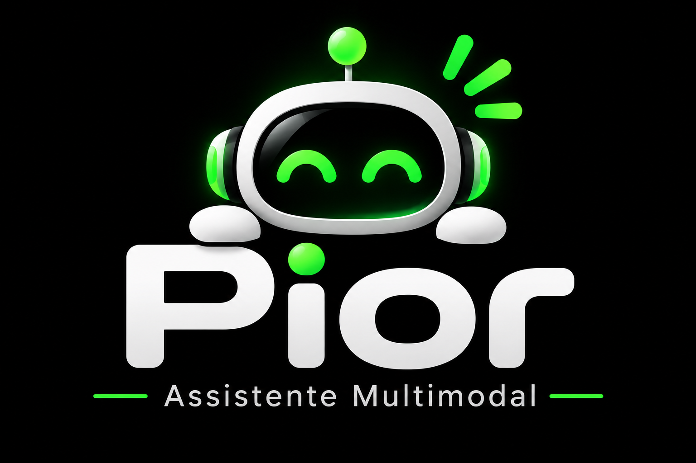

# PIOR - Assistente Multimodal de Voz e Visão para Desktop 👁️🎙️⚡

<p align="center">
  
</p>

<p align="center">
  <strong>Assistente inteligente desktop estilo Jarvis com IA local multimodal, visão em tempo real de telas unificadas e webcam, síntese e reconhecimento de voz sem markdown, pesquisa na web e integração com o sistema operacional.</strong>
</p>

<p align="center">
  
  
  
  
  
</p>

---

## 🌟 Funcionalidades Principais

- 👁️ **Visão Multimodal em Tempo Real**:
  - **Telas Unificadas e Múltiplos Monitores**: Leitura de OCR de alta fidelidade em resolução nativa (Full HD), reconhecimento de código, janelas, menus e tradução instantânea.
  - **Identificação de Wallpaper e Desktop**: Detecta e descreve arte, tema, personagens e estilos visuais da área de trabalho por trás de janelas abertas.
  - **Detecção de E-Commerce & Cupons**: Identifica lojas e produtos em exibição e faz busca instantânea de cupons de desconto ativos.
  - **Webcam em Tempo Real**: Reconhecimento de quadros, capas de álbuns, roupas, cores, gestos com as mãos e audiodescrição do ambiente.
- 🎙️ **Voice-First Oral (Sem Markdown)**:
  - Fala natural em Português do Brasil, sem caracteres de markdown (sem asteriscos, cerquilhas ou tabelas) para garantir uma reprodução limpa pelo sintetizador de voz.
  - Cancelamento de monólogos e pensamentos internos da LLM para latência instantânea.
- 🧠 **Cérebro de IA 100% Local (Ollama)**:
  - Modelo especializado **`pior-vl:8b`** construído via `Modelfile` sobre o `qwen3-vl:8b-instruct`.
  - Suporte e troca a quente entre modelos locais (`qwen3:8b`, `qwen3:14b`, `qwen3-vl:32b`).
  - Telemetria de GPU (VRAM, temperatura, utilização) e RAM em tempo real.
- 💻 **Integração com o Computador**:
  - **Redação de E-mails Interativa**: Fluxo conversacional inteligente em dois turnos (pergunta o que deseja no corpo e gera card interativo com botões de cópia e envio `mailto:`).
  - **Agendamento no Calendário**: Geração automática de arquivos `.ics` compatíveis com Windows Calendar, Outlook e Google Calendar.
  - **Criação de Arquivos Locais**: Salva anotações, atas e códigos diretamente em disco na pasta `documentos_pior/`.
- 🌐 **Pesquisa na Web Desacoplada**:
  - Pesquisa factual em tempo real via DuckDuckGo (`ddgs`) ativada sob demanda, sem atrasar perguntas puramente visuais.

---

## 📂 Estrutura do Repositório

```text
tcc/
├── assets/                    # Identidade visual e imagens do projeto
│   └── logo_pior.png          # Logo oficial do assistente PIOR
├── src/                       # Código-fonte principal da aplicação
│   ├── main.py                # Servidor FastAPI e sensory perception hub
│   ├── ollama_manager.py      # Gestão de modelos Ollama e telemetria de GPU/RAM
│   ├── vision.py              # Captura e processamento de frames (webcam e telas)
│   ├── actions.py             # Ações no SO (e-mail interativo, calendário .ics, arquivos)
│   ├── web_search.py          # Pesquisa web e busca de cupons em tempo real
│   └── static/
│       ├── index.html         # Interface web moderna com tema neon dark, HUD e canvas
│       └── logo.png           # Ícone estático
├── tests/                     # Bateria de testes automatizados e manuais
│   ├── test_api.py            # Testes de integração das rotas FastAPI
│   ├── test_ollama_manager.py # Testes dos utilitários de telemetria e troca de modelos
│   └── manual/                # Scripts de validação e testes visuais pontuais
├── eval/                      # Benchmarks e avaliação dos 20 cenários de uso
│   ├── bateria_20_cenas.py    # Teste de conformidade dos 20 cenários
│   └── benchmark_latencia.py  # Medição de latência e tempo de inferência
├── scripts/                   # Utilitários de diagnóstico e consulta
├── documentos_pior/           # Diretório de arquivos e compromissos gerados pelo assistente
├── tmp/                       # Diretório para gravações e buffers temporários
├── Modelfile                  # Definição e fine-tuning do modelo pior-vl:8b no Ollama
├── training_scenarios.json    # Especificação dos 20 cenários multimodais testados
├── requirements.txt           # Dependências Python do projeto
├── Dockerfile                 # Containerização da aplicação
├── docker-compose.yml         # Orquestração do stack completo
├── run_pior.py                # Script lançador da aplicação com auto-abertura no navegador
└── iniciar_local_python.bat   # Script Windows para inicialização em 1 clique
```

---

## 🚀 Como Executar

### Pré-requisitos
1. **Python 3.10+** (Recomendado: 3.12)
2. **Ollama** instalado e em execução ([ollama.com](https://ollama.com)):
   ```bash
   ollama pull qwen3-vl:8b-instruct
   ```
3. *(Opcional, mas recomendado)* Crie o modelo ajustado do PIOR:
   ```bash
   ollama create pior-vl:8b -f Modelfile
   ```

### Execução Local (Python)

1. Clone o repositório:
   ```bash
   git clone https://github.com/SEU_USUARIO/pior-assistant.git
   cd pior-assistant
   ```

2. Crie e ative um ambiente virtual:
   ```bash
   python -m venv .venv
   # No Windows:
   .venv\Scripts\activate
   # No Linux/Mac:
   source .venv/bin/activate
   ```

3. Instale as dependências:
   ```bash
   pip install -r requirements.txt
   ```

4. Configure o arquivo de ambiente:
   ```bash
   copy .env.example .env   # No Linux: cp .env.example .env
   ```

5. Inicie o assistente:
   ```bash
   # Opção 1: Via script lançador
   python run_pior.py

   # Opção 2: Diretamente via Uvicorn
   uvicorn src.main:app --host 0.0.0.0 --port 8000 --reload
   ```

6. Acesse a interface no seu navegador em **`http://localhost:8000`**.

> **Dica Windows**: Você também pode simplesmente dar duplo clique em `iniciar_local_python.bat`.

---

### Execução via Docker

```bash
docker compose up --build
```
Acesse `http://localhost:8000`.

---

## 🧪 Executando os Testes Automatizados

Para rodar a suíte completa de testes com o `pytest`:
```bash
pytest
```

---

## 📄 Licença

Este projeto é distribuído sob a licença **MIT**. Veja o arquivo `LICENSE` para mais detalhes.
